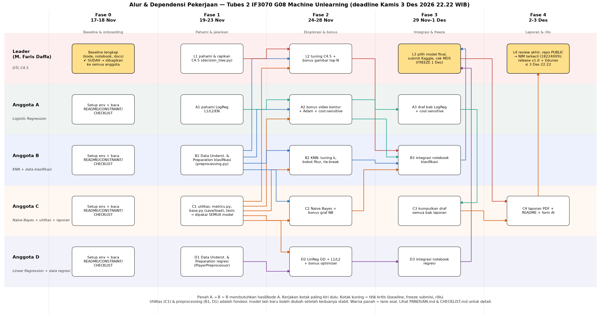

# PANDUAN.md — Konteks Proyek & Cara Kerja
## Tugas Besar 2 IF3070 Dasar Inteligensi Artifisial · Kelompok G08 "Machine Unlearning"

> **Untuk siapa:** anggota kelompok dan **AI assistant** yang mereka pakai. Dokumen ini adalah **rujukan teknis**: apa yang dibangun, kenapa begitu, dan bagaimana cara bekerjanya.
> **Bukan bacaan pertama.** Urutan baca: `README.md` → `CONSTRAINT.md` (aturan, wajib) → `CHECKLIST.md` (tugasmu, wajib) → lalu buka dokumen ini dan `MATERI.md` (teori) **sesuai kebutuhan**.
> **Pembagian tugas, bobot beban kerja, dan timeline** ada di `CHECKLIST.md`. Spek resmi: `instruction/spek.md`.
> **Status per 17 Nov 2026:** baseline **lengkap dan berjalan**. Semua kode, kedua notebook, submisi Kaggle, dan bonus sudah dibuat oleh leader. Tugas anggota adalah **memahami, menguji, memperbaiki, dan menulis laporan** bagiannya, serta **mengeksplorasi** cara menaikkan skor.

| Bagian | Isi |
| --- | --- |
| §1–2 | Ringkasan proyek, tujuan dan kriteria sukses |
| §3–4 | Struktur repo, arsitektur kode, alur notebook |
| §5–6 | Keputusan desain beserta alasannya, hasil baseline |
| §7–8 | Setup environment, alur Git |
| §9 | Reproducibility dan protokol submisi Kaggle |
| §10 | Protokol eksperimen dan daftar ide eksplorasi (E1 dan seterusnya) |
| §11–14 | Definition of Done, laporan, memakai AI, komunikasi |

---

## 1. Ringkasan proyek (bahasa awam)

Ada dua "soal" yang harus diselesaikan dengan *machine learning* (mesin belajar dari contoh):

|                        | **Soal 1: Deteksi Phishing** (klasifikasi)   | **Soal 2: Rating Pemain** (regresi)            |
| ---------------------- | -------------------------------------------- | ---------------------------------------------- |
| Pertanyaan             | "Apakah URL ini situs penipuan (phishing)?"  | "Berapa rating (47–91) pemain sepak bola ini?" |
| Data latih             | 8.021 URL, 81 fitur, label 0/1               | 12.883 pemain, 48 fitur, rating                |
| Data uji               | 3.409 URL (tanpa label)                      | 5.522 pemain (tanpa rating)                    |
| Yang dikirim ke Kaggle | **peluang** phishing 0–1                     | **angka** rating                               |
| Metrik Kaggle          | **ROC-AUC** (makin besar makin baik, maks 1) | **RMSE** (makin kecil makin baik)              |
| Bobot nilai bonus      | **70%**                                      | 30%                                            |

Selain skor Kaggle, nilai utama datang dari: implementasi algoritma **from scratch** (ditulis sendiri dengan NumPy), perbandingan dengan scikit-learn, notebook yang rapi dan **reproducible**, serta laporan PDF.

**Istilah penting:**
* *fitur* = kolom input;
* *target/label* = kolom yang ditebak;
* *train* = data latihan yang ada jawabannya;
* *test* = data ujian dari Kaggle yang tidak ada jawabannya;
* *validasi* = sebagian train yang disembunyikan untuk menguji model;
* *CV* (*cross-validation*) = train dibagi 5 bagian, lalu bergiliran 1 bagian jadi ujian dan 4 bagian jadi latihan;
* *overfitting* = model hafal data latih tapi gagal di data baru.

---

---

## 2. Tujuan & kriteria sukses

- **G1**: Checklist wajib di `CHECKLIST.md` bagian 0 tercentang semua
  - Tujuan: Semua spek wajib terpenuhi
  - Status baseline: ✅ kode & notebook
- **G2**: CV AUC ≥ 0.987, CV RMSE ≤ 0.43
  - Tujuan: Skor Kaggle tinggi (bonus rank 1–3 = 5 poin)
  - Status baseline: ✅ AUC 0.9876, RMSE 0.425
- **G3**: Menjalankan ulang notebook menghasilkan file submisi dengan **MD5 identik**
  - Tujuan: Reproducible
  - Status baseline: ✅ dicek (lihat §9)
- **G4**: tree top-N, video kontur, graf NB, optimizer, cost-sensitive
  - Tujuan: Bonus non-Kaggle
  - Status baseline: ✅ semua ada
- **G5**: Komponen sesuai `CONSTRAINT.md` R-03
  - Tujuan: Laporan PDF lengkap
  - Status baseline: ⏳ tugas tim
- **G6**: Tiap anggota punya commit, bab laporan, dan bisa menjelaskan kodenya
  - Tujuan: Setiap anggota paham & berkontribusi
  - Status baseline: ⏳ tugas tim

---

---

## 3. Struktur repository

```
IF3070_G08_MachineUnlearning/
├── README.md                       # deskripsi, setup, cara run, pembagian tugas (WAJIB spek)
├── CONSTRAINT.md / CHECKLIST.md / PANDUAN.md / MATERI.md
├── AGENTS.md                       # pointer otomatis untuk AI assistant
├── requirements.txt                # versi library terkunci (reproducibility)
├── data/
│   ├── klasifikasi/{train,test,sample_submission}.csv
│   └── regresi/{train,test,sample_submission}.csv
├── src/
│   ├── models/                     # ← SEMUA MODEL FROM SCRATCH (NumPy saja)
│   │   ├── base.py                 # BaseModel: save()/load() via pickle
│   │   ├── knn.py                  # KNNClassifier, KNNRegressor
│   │   ├── decision_tree.py        # C45DecisionTree (+ pruning, export_text)
│   │   ├── logistic_regression.py  # LogisticRegression (L1/L2/ElasticNet, class_weight)
│   │   ├── naive_bayes.py          # NaiveBayes (kategorikal + Gaussian)
│   │   ├── linear_regression.py    # LinearRegression (GD / normal eq, L1/L2)
│   │   └── optimizers.py           # gd / momentum / adam + lr_decay (bonus)
│   ├── preprocessing.py            # PhishingPreprocessor, PlayerPreprocessor, scaler, binner, SoftmaxClassifier
│   ├── metrics.py                  # AUC, F1, RMSE, R2, k-fold, skor kompetisi, biaya cost-sensitive
│   ├── visualization.py            # plot pohon top-N, graf NB, video kontur, plot regresi
│   ├── tubes2_klasifikasi.ipynb    # notebook template 11 section — phishing
│   └── tubes2_regresi.ipynb        # notebook template 11 section — rating
├── tests/test_models.py            # 14 uji kebenaran (vs contoh slide & sklearn)
├── tools/                          # build_*.py (generator notebook), run_all.sh, make_diagram.py
├── output/
│   ├── submissions/                # submission_klasifikasi.csv, submission_regresi.csv
│   ├── models/                     # *.pkl (model & preprocessor tersimpan)
│   └── figures/                    # pohon, graf NB, video kontur, plot regresi
├── docs/                           # laporan PDF (nanti) + diagram_alur_kerja.png
└── instruction/                    # spek.md + PDF, desc Kaggle, template_notebook_asisten.ipynb,
                                    # materi_kelas/, transkrip_video/, transkrip_dtl/
```

> **Catatan notebook:** `src/*.ipynb` **dibangkitkan** oleh `tools/build_klasifikasi.py` dan `tools/build_regresi.py`. Kamu **boleh langsung mengedit notebook** di Jupyter/VS Code. Kalau begitu, beri tahu leader agar builder tidak menimpa editanmu (lihat §8.4).

---

---

## 4. Arsitektur kode & alur notebook

### 4.1 Interface model (semua kelas di `src/models/`)
```python
model = NamaModel(**hyperparameter)      # tidak ada perhitungan di __init__
model.fit(X_train, y_train)               # belajar dari data latih (X: array/DataFrame)
model.predict(X)                          # label (klasifikasi) / angka (regresi)
model.predict_proba(X)                    # klasifikasi saja: array (n, 2), kolom 1 = P(kelas 1)
model.save("output/models/x.pkl");  NamaModel.load("output/models/x.pkl")
```
Atribut hasil training diberi akhiran `_` (mis. `coef_`, `root_`, `feature_weights_`).

### 4.2 Interface preprocessing
```python
pre = PhishingPreprocessor(mode="knn")    # mode: 'tree' | 'nb' | 'knn' | 'linear'
pre.fit(train_df)                         # hitung statistik HANYA dari train
X_tr, X_va = pre.transform(train_df), pre.transform(val_df)

pre = PlayerPreprocessor()                # regresi
```
Fungsi bantu di notebook: `make_data(...)` (fit + transform) dan `cv_auc(...)` / `cv_rmse(...)` (5-fold CV dengan preprocessing di-fit ulang di tiap fold).

### 4.3 Alur data
```
train.csv ──split──► train_set ──fit──► Preprocessor ──transform──► X_tr ──fit──► Model
                └──► val_set  ─────────────────────── transform──► X_va ──predict──► metrik
test.csv ─────────────────────────────── transform (pakai fit dari SELURUH train) ──► submisi
```

---

### 4.4 Alur notebook (CRISP-DM → 11 section)



Kedua notebook (`src/tubes2_klasifikasi.ipynb`, `src/tubes2_regresi.ipynb`) memakai 11 section **template asisten**. Pemetaannya ke CRISP-DM (`MATERI.md` §2):

- **1**: Overview, Aim, Metric (ROC-AUC), Dataset, Approach
  - Section notebook: Introduction
  - Fase CRISP-DM: Business Understanding
  - Isi di regresi (rating): sama, metrik RMSE
- **2**: import, `Settings`, seed 42, load CSV (`id` sebagai teks)
  - Section notebook: Initialization
  - Fase CRISP-DM: –
  - Isi di regresi (rating): sama
- **3**: tipe fitur, distribusi target, korelasi, missing, sentinel −1
  - Section notebook: Data Understanding
  - Fase CRISP-DM: Data Understanding
  - Isi di regresi (rating): korelasi, efek atribut per posisi, noise `level_liga`
- **4**: stratified 80/20 + 5-fold stratified
  - Section notebook: Training & Validation Split
  - Fase CRISP-DM: Modeling (bagi data)
  - Isi di regresi (rating): 80/20 + 5-fold
- **5**: select, missing (per model), outlier (kuantil), encoding, binning, PCA (ditolak), class balance
  - Section notebook: Data Preparation
  - Fase CRISP-DM: Data Preparation
  - Isi di regresi (rating): log uang, imputasi regresi, penebak posisi, interaksi, standarisasi
- **6**: `make_data`, `cv_auc`
  - Section notebook: Preparation Pipeline
  - Fase CRISP-DM: Data Preparation
  - Isi di regresi (rating): `make_data`, `cv_rmse`
- **7**: KNN, C4.5, LogReg (L1/L2/EN), NB + tabel evaluasi + tuning
  - Section notebook: Modeling & Validation
  - Fase CRISP-DM: Modeling
  - Isi di regresi (rating): LinReg GD/Adam/normal eq, L1, L2, KNNRegressor + ablation
- **8**: tabel AUC/F1 scratch vs sklearn
  - Section notebook: Comparison with scikit-learn
  - Fase CRISP-DM: Evaluation
  - Isi di regresi (rating): MAE/RMSE/R² + plot pred-vs-actual & residual
- **9**: `.save()`/`.load()`
  - Section notebook: Saving & Loading
  - Fase CRISP-DM: Deployment (mini)
  - Isi di regresi (rating): sama
- **10**: fit di seluruh train → prediksi test → CSV + MD5
  - Section notebook: Kaggle Submission
  - Fase CRISP-DM: Deployment
  - Isi di regresi (rating): sama, clip [47, 91]
- **11**: profil FN/FP, **bonus cost-sensitive**, bonus pohon, graf NB, video
  - Section notebook: Error Analysis
  - Fase CRISP-DM: Evaluation
  - Isi di regresi (rating): MAE per posisi, kasus terburuk

**Prinsip yang tidak boleh dilanggar** (detail di `CONSTRAINT.md`):
1. Split dulu, baru preprocessing.
2. Preprocessing `fit` hanya pada data latih.
3. Model hanya NumPy.
4. Pilih model berdasarkan **CV**, bukan public leaderboard.
5. Setiap keputusan diberi **Insight**.

---

---

## 5. Keputusan desain & alasannya (WAJIB dipahami sebelum mengubah)

### 5.1 Klasifikasi (phishing)
- **DTL varian **C4.5****: Paling lengkap di slide & video Bu Ulfa. Menangani numerik (threshold), kategorikal (multiway), dan missing (bobot pecahan).
- **C4.5 **tanpa imputasi****: Missing ditangani native (slide hal. 45). CV AUC C4.5 kita 0.97 vs pohon sklearn yang butuh imputasi 0.94–0.95.
- **KNN: **quantile scaling** ke [0,1] (di luar slide)**: Slide-first: min-max (slide hal. 84) dicoba dulu → AUC 0.977, karena data terjepit dekat 0 akibat pencilan ekstrem. Quantile → 0.988. Tabel langkah demi langkah ada di notebook section 7.
- **LogReg: fitur kontinu **standarisasi z-score****: Cara standar; setara dengan versi quantile (0.9871 vs 0.9869), jadi dipakai yang sederhana.
- **LogReg: **SGA slide** diverifikasi, final **mini-batch + Adam****: Implementasi SGA identik dengan contoh slide hal. 29. Pada 390 fitur, SGA 20 epoch → 0.983 vs Adam → 0.987.
- **C4.5 pruning: **REP greedy** & **rule post-pruning** (slide)**: Menaikkan akurasi (0.912 → 0.919/0.922) dan menyederhanakan model, tetapi AUC turun (peluang kasar). Pohon penuh dipakai untuk AUC, versi terpangkas untuk interpretasi.
- **KNN: **Manhattan + bobot jarak****: Manhattan > Euclidean (0.986 vs 0.983); bobot 1/d memberi peluang halus untuk AUC.
- **KNN: **bobot fitur √|2·AUC−1|****: Fitur lemah tidak mengacaukan jarak (kelemahan KNN di slide hal. 8). 0.9860 → 0.9876.
- **LogReg: **binning kuantil 10 + one-hot + indikator missing + Elastic Net****: Membuat model linear menangkap pola non-linear. Tanpa bin 0.980 → dengan bin 0.987.
- **NB: **diskretisasi 20 bin****: Gaussian tidak cocok untuk fitur condong. Gaussian 0.94 → binned 0.965.
- **Nilai **−1** (usia_domain dll.) dipertahankan**: Artinya "tidak tersedia", jadi informatif (slide hal. 46).
- **`indeks_google=1` berasosiasi phishing**: Berlawanan dengan kamus data; kemungkinan pengkodean terbalik. Jangan diinterpretasi sebagai "terindeks = berbahaya" tanpa catatan.
- **Model submisi: KNN** (k=21): CV AUC tertinggi (0.9876). LogReg EN sangat dekat (0.9871).
- **PCA **tidak dipakai****: Dicoba; AUC turun (0.9850 → 0.983 dengan 40 komponen).

### 5.2 Regresi (rating)
- **`level_liga` **dibulatkan****: 61% nilai diberi noise ±0.08 (data error).
- **Kolom uang **log1p****: Hubungan log(nilai_pasar) vs rating hampir linear.
- **Imputasi regresi** (LinearRegression normal eq): median 0.517 → regresi 0.425. Contoh: kiper_refleks ditebak dari atribut kiper lain dengan R² 0.96.
- **posisi_utama hilang → **SoftmaxClassifier** (soft)**: Slide-first: KNN (slide) dicoba dulu → RMSE 0.4376. Softmax → 0.4248. Peluang soft 0.425 vs tebakan keras 0.433.
- **Interaksi atribut teknis × posisi**: Rating dihitung dengan bobot berbeda per posisi. Tanpa interaksi 1.285 → dengan interaksi 0.425. **Langkah terpenting.**
- **Training **GD + Adam + lr_decay** (5000 epoch)**: GD biasa sangat lambat (ill-conditioned, 477 fitur). Adam + decay mencapai minimum yang sama dengan normal equation. Spek mewajibkan GD.
- **Tanpa regularisasi untuk submisi**: L1/L2 sedikit memperburuk karena model belum overfit.
- **Prediksi di-**clip** ke [47, 91]**: Rentang rating valid menurut kamus data.
- **Tidak** membulatkan prediksi: Pembulatan memperburuk RMSE (0.52 → 0.58 saat eksplorasi).

---

---

## 6. Hasil baseline (angka resmi, 5-fold CV, seed 42)

| Task        | Model                                                  | CV               | Holdout val          | Catatan     |
| ----------- | ------------------------------------------------------ | ---------------- | -------------------- | ----------- |
| Klasifikasi | **KNN** k=21, manhattan, distance, bobot fitur AUC^0.5 | **AUC 0.9876**   | AUC 0.9875, F1 0.944 | **submisi** |
| Klasifikasi | LogReg Elastic Net (α=0.01, l1_ratio=0.1)              | AUC 0.9871       | AUC 0.9871           |             |
| Klasifikasi | C4.5 gain ratio, min_leaf 5, Laplace 1                 | AUC 0.967–0.971  | AUC 0.969            |             |
| Klasifikasi | Naive Bayes binned 20                                  | AUC 0.9645       | AUC 0.966            |             |
| Regresi     | **LinReg GD-Adam** + interaksi + soft posisi           | **RMSE ≈ 0.425** | RMSE 0.4196          | **submisi** |
| Regresi     | KNN Regressor                                          | –                | RMSE 2.08            | pembanding  |

Perkiraan skor: AUC_norm ≈ 0.975, RMSE_norm ≈ 0.939, sehingga **Skor ≈ 0.964**. Angka pasti ada di output notebook setelah dijalankan.

---

---

## 7. Setup environment (langkah demi langkah)

> Cukup sekali per laptop. Butuh **Python 3.12** dan **git**.

```bash
# 1) clone repo (link dari leader)
git clone https://github.com/<akun-leader>/IF3070_G08_MachineUnlearning.git
cd IF3070_G08_MachineUnlearning

# 2) buat virtual environment (folder .venv) dan aktifkan
python3.12 -m venv .venv
source .venv/bin/activate            # Windows: .venv\Scripts\activate

# 3) install library dengan versi yang sama persis
pip install -r requirements.txt

# 4) cek semua model benar (harus "Semua 14 test lulus.")
python tests/test_models.py

# 5) jalankan kedua notebook dari awal sampai akhir (±7 menit) + cetak MD5 submisi
bash tools/run_all.sh                # Windows: jalankan "Restart & Run All" di Jupyter
```
Membuka notebook: `jupyter lab` lalu buka `src/tubes2_klasifikasi.ipynb`, atau pakai VS Code dengan kernel `.venv`.

**Masalah umum:**
* `ModuleNotFoundError: src`: jalankan notebook dari folder `src/` atau root repo. Sel import sudah otomatis menambahkan path.
* Versi Python berbeda: pastikan `python --version` adalah 3.12.x. Versi lain bisa membuat MD5 submisi berbeda.

---

---

## 8. Alur Git (branching & commit)

### 8.1 Branch
* `main` = **selalu bisa dijalankan**. Tidak boleh push langsung ke `main` (kecuali leader saat setup).
* Setiap orang bekerja di branch sendiri: `feat/<area>-<nama>`, misalnya `feat/knn-budi`, `feat/naive-bayes-sari`, `docs/laporan-logreg-andi`, `fix/c45-missing-faris`.

```bash
git checkout main && git pull                  # selalu mulai dari main terbaru
git checkout -b feat/knn-budi                  # buat branch
# ... kerjakan ...
git add src/models/knn.py
git commit -m "feat(knn): tambah tie-breaking skor dari jarak tetangga"
git push -u origin feat/knn-budi               # lalu buat Pull Request di GitHub
```

### 8.2 Semantic commit (disarankan spek)
Format: `tipe(area): deskripsi singkat dalam bahasa Indonesia`

| Tipe       | Kapan                    | Contoh                                            |
| ---------- | ------------------------ | ------------------------------------------------- |
| `feat`     | fitur/fungsi baru        | `feat(logreg): tambah proximal L1 (ISTA)`         |
| `fix`      | perbaiki bug             | `fix(c45): threshold salah saat semua nilai sama` |
| `exp`      | eksperimen + hasilnya    | `exp(knn): weighting_power 0.75 -> CV AUC 0.9879` |
| `docs`     | dokumen/laporan          | `docs(laporan): bab naive bayes`                  |
| `test`     | tambah/ubah test         | `test(nb): cek laplace smoothing`                 |
| `refactor` | rapikan tanpa ubah hasil | `refactor(preprocessing): pisah fungsi binning`   |
| `chore`    | lain-lain (deps, config) | `chore: update requirements`                      |

Commit **kecil dan sering**, karena commit menjadi bukti kontribusi tiap anggota.

### 8.3 Pull Request (PR)
1. Judul = semantic commit utama. Deskripsi berisi: apa yang diubah, **hasil CV sebelum vs sesudah**, dan konfirmasi bahwa test lulus.
2. Assign **leader** sebagai reviewer. Leader me-merge setelah lulus *Definition of Done* (§11).
3. Satu PR = satu topik. Jangan campur perubahan KNN dan laporan dalam satu PR.

### 8.4 Notebook & konflik merge (penting!)
File `.ipynb` berbentuk JSON besar, sehingga **gampang konflik** bila dua orang mengedit bersamaan.
* **Pemilik notebook:** klasifikasi = **Anggota B**, regresi = **Anggota D**. Orang lain **tidak** mengedit notebook langsung. Kirim perubahan dalam bentuk kode di `src/` dan minta pemilik notebook mengintegrasikan.
* Notebook awalnya dibangkitkan oleh `tools/build_klasifikasi.py` / `tools/build_regresi.py`. **Mulai fase 1, notebook diedit langsung** (Jupyter/VS Code) oleh pemiliknya, dan builder **tidak dipakai lagi** agar tidak menimpa editan. Leader akan menandai ini di README.
* Sebelum commit notebook: **Restart & Run All** supaya output urut dan konsisten.

---

---

## 9. Reproducibility & submisi Kaggle

### 9.1 Reproducibility (jangan sampai gagal, taruhannya poin Kaggle)

* Seed global 42. Split, fold, dan mini-batch memakai `np.random.default_rng(42)`.
* KNN dan C4.5 deterministik. LinReg final memakai **full-batch** GD, jadi tidak ada pengacakan.
* Versi library dikunci di `requirements.txt`.
* Setiap notebook mencetak **MD5** file submisi. Hash yang dikirim ke Kaggle dicatat di `README.md`.
* Cara cek: `bash tools/run_all.sh`, lalu bandingkan MD5 yang tercetak dengan yang tercatat.
* **Aturan:** submisi final Kaggle **hanya** dibuat dari notebook di branch `main` setelah run bersih (lihat §9.2).

---

### 9.2 Protokol submisi Kaggle

1. **Hanya leader** yang mengirim submisi final. Anggota yang ingin mencoba model lain mengirimkan **hasil CV** di PR. Public leaderboard hanya memakai 30% test, sehingga gampang menipu.
2. Kandidat submisi harus: (a) lebih baik di **5-fold CV** dibanding model saat ini, (b) lolos CONSTRAINT K-06 (from scratch, tanpa ensemble), (c) dihasilkan dari notebook di `main` setelah **Restart & Run All**.
3. Setelah submit: catat di README tabel *Riwayat Submisi* (tanggal, file, MD5, CV, skor public LB).
4. **FREEZE 1 Des 2026.** Pilih 1 submisi final di Kaggle ("Select for final score") yang **sama persis** dengan output notebook final (cek MD5).
5. Uji reproducibility terakhir: clone repo bersih di folder baru, lalu ikuti §7. MD5 harus identik.

---

---

## 10. Protokol eksperimen & ruang eksplorasi

### 10.1 Protokol eksperimen

1. Selalu ukur dengan `cv_auc(...)` / `cv_rmse(...)` (5-fold, seed 42). Jangan memakai satu split saja.
2. Ubah **satu hal** dalam satu waktu (*one factor at a time*, `MATERI.md` §5.1).
3. Catat setiap percobaan, termasuk yang gagal. Percobaan gagal tetap berguna sebagai bahan laporan. Tabel log disimpan di `docs/log_eksperimen.md`:

| Tanggal | Siapa | Task | Perubahan                       | CV sebelum | CV sesudah | Dipakai? | Catatan |
| ------- | ----- | ---- | ------------------------------- | ---------- | ---------- | -------- | ------- |
| 17/11   | Faris | klas | baseline KNN k=21 bobot AUC^0.5 | –          | 0.9876     | ✅       |         |
| 17/11   | Faris | reg  | posisi soft (softmax) vs keras  | 0.4331     | 0.4248     | ✅       |         |

4. Teknik dari luar materi wajib diberi referensi (CONSTRAINT I-05). Bila itu algoritma optimasi baru, beri tahu leader agar bisa diklaim **bonus B-05**.

---

### 10.2 Ruang eksplorasi (untuk menaikkan skor), dengan pemilik yang disarankan

Setiap eksperimen **wajib** diukur dengan **5-fold CV** memakai fungsi `cv_auc` / `cv_rmse` (bukan public leaderboard). Catat hasilnya di tabel log eksperimen (lihat §10.1).

- **E1**: KNN: *tie-breaking* peluang 0/1 (mis. tambah skor kecil dari jarak ke tetangga phishing terdekat)
  - Pemilik: B
  - Potensi: sedang (banyak skor seri di 0 dan 1)
  - Batasan: tetap satu model KNN
- **E2**: KNN: tuning `weighting_power`, k, metrik Minkowski p=1.5
  - Pemilik: B
  - Potensi: kecil-sedang
- **E3**: KNN: bobot fitur dari koefisien LogReg atau information gain
  - Pemilik: B
  - Potensi: sedang
  - Batasan: jelaskan sumber
- **E4**: LogReg: fitur interaksi (indeks_google × usia_domain, dll.), jumlah bin, α
  - Pemilik: A
  - Potensi: sedang
- **E5**: LogReg: proximal L1 (ISTA) agar bobot tepat 0
  - Pemilik: A
  - Potensi: kecil (bisa diklaim bonus optimizer + referensi)
- **E6**: C4.5: tuning min_samples_leaf/laplace; analisis aturan hasil rule post-pruning untuk laporan
  - Pemilik: Leader
  - Potensi: kecil untuk AUC, bagus untuk laporan
- **E7**: NB: jumlah bin per fitur, alpha, buang fitur berkorelasi tinggi (asumsi independen)
  - Pemilik: C
  - Potensi: kecil
- **E8**: Regresi: penebak posisi lebih akurat (fitur tambahan: tinggi, berat, kaki_lemah)
  - Pemilik: A (+D)
  - Potensi: sedang (posisi kosong = 11% kuadrat error)
  - Batasan: tetap preprocessing
- **E9**: Regresi: interaksi tambahan (atribut × tipe_badan, `reaksi²`)
  - Pemilik: D
  - Potensi: kecil-sedang
  - Batasan: tetap linear di parameter
- **E10**: Regresi: imputasi atribut kiper khusus untuk kiper
  - Pemilik: D
  - Potensi: kecil
- **E11**: KNN klasifikasi: indikator nilai kosong & WHOIS −1 sebagai fitur
  - Pemilik: B
  - Potensi: kecil-sedang
- **E12**: Regresi: fitur uang tak-linear (bin 20 + x², x³ + interaksi × usia/potensi)
  - Pemilik: D
  - Potensi: **besar** (sudah diuji: CV 0,4248 → 0,4122)
  - Batasan: fit bin dari train saja
- **E13**: Regresi: bonus reputasi (reputasi 3–5 digabung × posisi)
  - Pemilik: D
  - Potensi: sedang (RMSE reputasi 3 = 0,72)
  - Batasan: gabungkan level langka
- **E15**: C4.5 pada residual regresi untuk menemukan segmen yang sering salah
  - Pemilik: Leader
  - Potensi: diagnosa (bukan submisi)
  - Batasan: bukan ensemble
- **E16**: Regresi: imputasi KNN (slide) vs regresi untuk kolom uang
  - Pemilik: B
  - Potensi: kecil-sedang
- **E17**: Rincian error per segmen otomatis + uji pembulatan setiap RMSE turun
  - Pemilik: C
  - Potensi: pendukung

> **Dilarang** untuk submisi: menggabungkan prediksi beberapa model (ensemble), memakai model sklearn, atau tuning dengan melihat label test (lihat `CONSTRAINT.md` K-06).

---

---

## 11. Definisi "selesai" (Definition of Done) untuk setiap perubahan kode

1. `python tests/test_models.py` → semua lulus.
2. Notebook terkait dijalankan dari atas sampai bawah tanpa error (`bash tools/run_all.sh`, atau "Restart & Run All").
3. Bila metrik berubah, angka di blok **Insight** dan di tabel §6 diperbarui.
4. Teknik baru di luar materi → komentar referensi di kode + entri di daftar referensi laporan.
5. Commit semantik + PR ke `main`, direview leader.

---

---

## 12. Alur laporan (PDF di `docs/`)

* **Editor bersama:** Google Docs (link dari Anggota C). Ekspor ke PDF di akhir.
* Setiap bab ditulis oleh pemilik bagiannya (lihat `CHECKLIST.md`), lalu Anggota C menyatukan dan merapikan format.
* Struktur wajib (CONSTRAINT R-03):
  1. **Cover**
  2. **Deskripsi Persoalan**: pemahaman dataset; ambil dari section 1 & 3 notebook (B untuk klasifikasi, D untuk regresi)
  3. **Pembahasan**
     * 3.1 Implementasi algoritma, satu subbab per algoritma (pemiliknya): deskripsi kelas/fungsi + potongan source code + kaitan dengan materi
     * 3.2 Cleaning & preprocessing + alasannya (B, D)
     * 3.3 Hasil & perbandingan dengan sklearn + visualisasi (pemilik masing-masing)
     * 3.4 Bonus: Kaggle (Leader), tree (Leader), video (A), graf NB (C), optimizer (A, D), cost-sensitive (A)
  4. **Kesimpulan & Saran** (Leader)
  5. **Pembagian tugas** (tabel CHECKLIST)
  6. **Referensi** (format IEEE seperti spek; daftar awal ada di `MATERI.md` §14)
  7. **Lampiran: Form Penggunaan Generative AI** (diisi jujur, CONSTRAINT I-03)
* Gambar diambil dari `output/figures/` atau screenshot output notebook.

---

---

## 13. Cara memakai AI assistant dengan benar

* Beri AI konteks: "baca `PANDUAN.md`, `CONSTRAINT.md`, `MATERI.md` dulu" (otomatis lewat `AGENTS.md`).
* Minta AI **menjelaskan** kode baris demi baris, lalu tulis ulang penjelasannya dengan bahasamu sendiri di laporan.
* Jangan menempel kode AI yang tidak kamu pahami (CONSTRAINT I-04).
* Catat penggunaan AI untuk **Form Penggunaan Generative AI** (CONSTRAINT I-03).
* Contoh prompt yang baik:
  > "Baca PANDUAN.md dan src/models/naive_bayes.py. Jelaskan dalam bahasa Indonesia sederhana bagaimana fungsi `_joint_log_likelihood` bekerja, kaitkan dengan contoh Play Tennis di MATERI.md §7.4."

---

## 14. Komunikasi

* **Grup chat** untuk koordinasi harian. Laporkan progres singkat tiap malam: "kemarin / hari ini / hambatan".
* Pertanyaan soal spek: cek `CONSTRAINT.md`, lalu tanya leader. Bila tetap ragu, tanyakan di **QnA Teams** (bukan chat pribadi asisten).
* Bila stuck > 1 jam: tanya di grup, sertakan pesan error dan langkah yang sudah dicoba.
